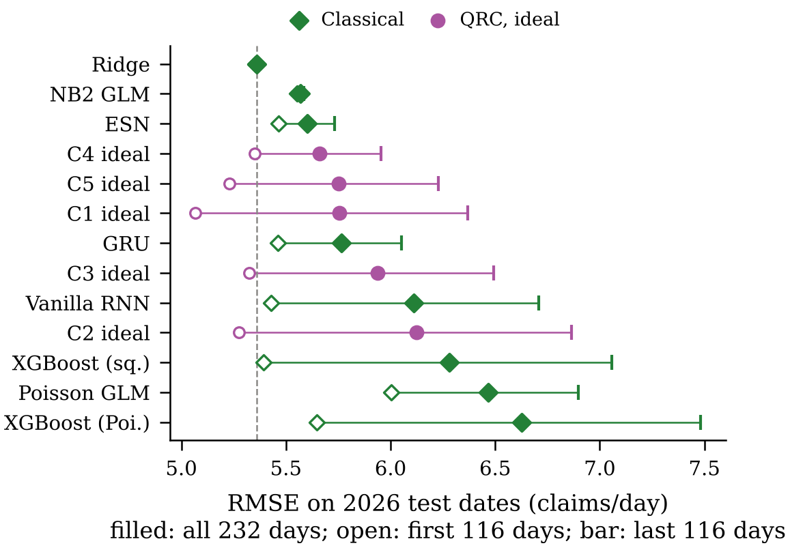
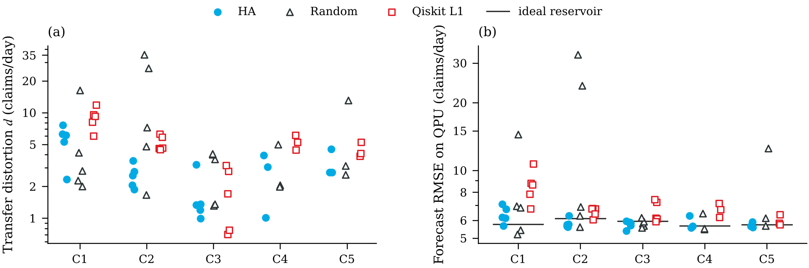

# Hardware-Aware Design and Layout Selection in Quantum Reservoir Computing for Insurance Claims Forecasting

This repository contains the data, code and recorded outputs needed to reconstruct the results of the article

> R. Rusnáková, E. Šlapak, G. K. Pandey, J. Gazda and M. Chovanec, *Hardware-Aware Design and Layout
> Selection in Quantum Reservoir Computing for Insurance Claims Forecasting*, submitted to IEEE Transactions
> on Quantum Engineering.
> Article link: *will be added after acceptance.*

Every table and data figure it reports can be
regenerated from the scripts below. Running new hardware rounds needs IBM Quantum time, but the complete records of all
63 IBM Kingston evaluations are included, so every hardware analysis runs offline.

The study asks two questions:

1. **Forecasting.** Can a six-qubit gate-based quantum reservoir (QRC) forecast next-day insurance claim
   counts competitively with classical models?
2. **Simulation-to-QPU transfer.** Can such a reservoir be designed and placed on a noisy superconducting
   processor so that its forecasts survive the transfer from simulation to hardware?

## Main results

All models were frozen on 2022–2025 data and scored once on the 232 held-out test days of 2026 (claims/day).

**Forecasting.** Ridge regression is the most accurate model, with an RMSE of 5.36. The five ideal (noiseless)
QRC candidates C1–C5 reach 5.66–6.12, which puts them alongside the ESN (5.60), GRU (5.76) and vanilla RNN
(6.11), and all five beat squared-error XGBoost (6.28). Four of the five cannot be separated from Ridge
under a 14-day circular-block bootstrap. The QRC follows day-to-day variation as well as Ridge does
(centered RMSE 5.03–5.45 against 5.35) but underpredicts by 1.5–3.1 claims/day. The underprediction grows
in the second half of 2026, as portfolio exposure moves beyond the training range of the bounded input
encoding (Table V and Fig. 4 of the article).



| Model | RMSE | Bias | cRMSE | Δ vs Ridge [95 % CI] |
|---|---|---|---|---|
| Ridge | 5.36 | +0.32 | 5.35 | — |
| NB2 GLM | 5.57 | +0.86 | 5.50 | +0.21 [−0.03, +0.46] |
| ESN (10 seeds) | 5.60 | +0.41 | 5.40 | +0.24 [+0.12, +0.35] |
| GRU (10 seeds) | 5.76 | −1.50 | 5.54 | +0.40 [−0.03, +0.80] |
| XGBoost (squared) | 6.28 | −3.67 | 5.10 | +0.92 [+0.16, +1.61] |
| QRC C1–C5, ideal | 5.66–6.12 | −1.54 to −3.12 | 5.03–5.45 | C2 only interval excluding 0 |

Full table: `results/tables/forecasting_comparison.csv`.

**Hardware transfer.** The five frozen candidates were run on IBM Kingston in 21 paired rounds, each with
three layout policies, for 63 evaluations in total:

- **Hardware-aware (HA):** calibration proxy, then calibrated Aer screening, then a short QPU probe on
  training dates.
- **Random-native:** a random native embedding that avoids faulty qubits.
- **Qiskit level 1:** the layout the level-1 transpiler chooses.

HA gave a lower forecast RMSE than Qiskit in all 21 rounds and a smaller transfer distortion *d* in 18 of
21. The largest *d* was 7.59 for HA and 11.84 for Qiskit. Random placement was sometimes better than HA (12
of 21 rounds favor HA, median difference 0.27), but it produced the four severe failures of the experiment
(*d* = 13.0–35.3), on degraded or broken couplers. In 44 of the 63 runs most of the distortion is a level shift.
The training-only QPU probe predicts the realized 2026 distortion with *r* = 0.88 (level shift *r* = 0.94).
Calibrated Aer underestimates it by a median factor of 4.2 (Tables VII and X, Figs. 5–7).



| Policy | Runs | Median QPU RMSE | Max QPU RMSE | Median *d* | Max *d* | Runs with *d* > 8 |
|---|---|---|---|---|---|---|
| Hardware-aware | 21 | 5.76 | 7.09 | 2.72 | 7.59 | 0 |
| Random-native | 21 | 6.15 | 32.63 | 3.61 | 35.28 | 4 |
| Qiskit level 1 | 21 | 6.76 | 10.68 | 4.62 | 11.84 | 4 |

Per candidate: `results/tables/hardware_by_candidate.csv`; every run: `results/runs.csv`.

**Memory and cost.** Longer replay windows did not help. C4 (117 steps) and C5 (64 steps) retain measurable
memory for only about 18 and 25 days, yet need 9360 and 2560 CZ gates per feature vector, against 80–240 for
C1–C3. They neither forecast better nor transfer more faithfully (Table VIII and Fig. 8 of the article,
`results/memory/`).

## Repository layout

```
requirements.txt              pinned Python packages (Python 3.11-3.13, 64-bit)
setup_venv.bat, setup_venv.sh create the virtual environment (Windows / macOS, Linux)
data/
  raw/qrc_daily_dataset.csv   insurer's daily export, the starting point of the study
  daily_claims.csv            forecasting data set: 1692 forecast origins (2022-01-01 .. 2026-08-19)
  classical_predictions/      reference 2026 predictions of the 36 classical runs (one configuration per family)
  design/                     recorded inputs and outputs of the reservoir design stages 05-10
  ibm_kingston_runs/          complete records of all IBM Kingston rounds (7-11 Oct 2026)
  iqm/                        IQM Emerald reservoir definition; iqm/design/ recorded IQM design outputs
  optimization_levels/        transpiler audit of Qiskit levels 1-3 made during the study
configs/
  classical_selected.json     the three cross-validated configurations of every classical family
  classical_final.json        the configuration of each family selected on 2025 (written by pipeline/04)
  fold_local_cv_summary.csv   ridge penalties and CV RMSE of the five frozen reservoirs
qrc/                          the quantum reservoir
  candidates.py               the five frozen candidates C1-C5, the graphs H0-H4, data loading
  reservoir.py                input encoding, Trotterized Hamiltonian, density-matrix features (RWP, CONT)
  circuits.py                 Qiskit circuits and conversion of counts to features
  readout.py                  ridge readout
  layouts.py                  native embeddings, strict compilation, HA proxy, random and Qiskit layouts
  noise.py                    storing and loading the calibrated Aer noise model of a round
  design.py                   memory capacity, washout, CV, reservoirs with any number of memory qubits
classical/models.py           Ridge, Poisson and NB2 GLMs, XGBoost, ESN, RNN, GRU
pipeline/                     the study in the order it was carried out (00 .. 13)
analysis/                     result tables, statistics and figures of the article
results/                      outputs of pipeline/ and analysis/ (all numbers quoted in the article)
figures/                      article figures (PDF and PNG)
```

## Installation

Use Python 3.11, 3.12 or 3.13 (64-bit). The pinned versions in `requirements.txt` are the ones used for the
article. The hardware rounds ran on Python 3.13 with Qiskit 2.5.2, Aer 0.17.2 and qiskit-ibm-runtime 0.49.0.

```
setup_venv.bat                 # Windows: creates C:\venvs\qrc_reproducibility
./setup_venv.sh                # macOS / Linux: creates .venv
```

To install by hand instead, run `python -m venv .venv`, activate it, then `pip install -r requirements.txt`.

## Main scripts

Run every script from the repository root. Each one overwrites its own outputs in `results/` (or `figures/`),
so `git diff` shows directly whether anything changed. Times are wall-clock on a two-core machine.

| Step | Command | Time | Reconstructs |
|---|---|---|---|
| Data | `python pipeline/00_prepare_data.py` | s | `data/daily_claims.csv` from the raw export |
| | `python pipeline/01_check_data.py` | s | chronology, alignment and split checks |
| | `python pipeline/02_data_analysis.py` | 2 min | Table II, F2/F3/F4 gate (`results/eda/`) |
| Classical | `python pipeline/03_classical_search.py --verify` | 2 min | CV scores of Table IX |
| | `python pipeline/04_classical_2026.py --compare data/classical_predictions` | 17 min | 2025 selection (Table IX), 36 runs on 2026 |
| Reservoir design | `python pipeline/05_design_architecture.py` | 25 min | memory size, CONT vs RWP, exposure encoding |
| | `python pipeline/06_design_graphs.py` | 1.5 min | native embeddings, coupling-search winners of H0-H4 |
| | `python pipeline/07_design_dynamics.py` | 35 min | Y field, observable sets, Trotter depth |
| | `python pipeline/08_design_rules.py` | 3 min | replay windows, rules R1-R4, 33 representatives |
| | `python pipeline/09_design_noise_screen.py` | s | calibrated-noise screen, Pareto front |
| | `python pipeline/10_design_freeze.py` | 1.5 min | Table III: the five frozen candidates |
| Ideal QRC | `python pipeline/11_ideal_reservoir.py` | 1 min | ideal 2025/2026 forecasts of C1-C5 (`results/ideal/`) |
| Hardware | `python pipeline/12_hardware_round.py ...` | QPU | one hardware round (see below) |
| IQM | `python pipeline/13_iqm_design.py` | 10 min | Sec. VII-E: IQM Emerald portability check |
| Analysis | `python analysis/build_run_table.py` | s | `results/runs.csv`, `results/daily.csv` from the raw IBM records |
| | `python analysis/statistics.py` | 20 s | Tables V and VII, paired tests, bootstrap (`results/tables/`) |
| | `python analysis/observables.py` | s | Fig. 6: observable contraction and shift |
| | `python analysis/distortion_model.py` | s | Fig. 7: pre-deployment predictors of distortion |
| | `python analysis/ideal_diagnostics.py` | 8 min | Table VI: inputs relative to the training range |
| | `python analysis/optimization_levels.py` | 10 s | Sec. VI: Qiskit levels 1-3 |
| | `python analysis/compute_final_candidate_memory.py --check` | 6 min | Table VIII: memory of the frozen candidates |
| | `python analysis/analyze_nonlinear_capacity.py` | 4 min | Sec. VII-C: nonlinear capacity (`results/capacity/`) |
| | `python analysis/timing_classical.py`, `python analysis/timing_qrc.py` | 1 min each | Sec. VII-D: computational cost |
| Figures | `python analysis/figures.py` | 10 s | Figs. 2, 4, 5, 6, 7 |
| | `python analysis/plot_final_candidate_memory.py` | s | Fig. 8 |

Figs. 1 and 3 of the article (workflow and circuit schematics) are drawings and are not generated here.
Steps 03 and 05-08 re-evaluate the recorded selections by default. The full searches are available with
`--family <name>` (03), `--search` (06, 07, 08, 13) and `--scan` (07); they take hours to days.

### Where each result of the article comes from

| Article | Script | Output |
|---|---|---|
| Table II, Sec. III-A (predictor screening, F2/F3/F4) | pipeline/02 | `results/eda/` |
| Fig. 2 (claims, exposure, clip level) | analysis/figures.py | `figures/fig_data.*` |
| Table III (frozen candidates) | pipeline/10, pipeline/11 | `results/design/freeze_candidates.csv`, `results/ideal/summary.csv` |
| Table IV (execution settings) | qrc/candidates.py, pipeline/12 | `data/ibm_kingston_runs/*/*/experiment.json` |
| Table V, Fig. 4 (forecasting) | pipeline/04, analysis/statistics.py | `results/tables/forecasting_comparison.csv`, `block_sensitivity.csv` |
| Table VI (inputs relative to training range) | analysis/ideal_diagnostics.py | `results/tables/ideal_encoding_range.csv` |
| Table VII, Fig. 5 (hardware by candidate and policy) | analysis/build_run_table.py, statistics.py | `results/runs.csv`, `results/tables/hardware_*.csv`, `paired_layouts.csv` |
| Fig. 6 (distortion mechanism) | analysis/observables.py | `results/observables.csv` |
| Fig. 7 (pre-deployment indicators) | analysis/distortion_model.py | `results/tables/distortion_predictors.csv` |
| Table VIII, Fig. 8 (memory) | analysis/compute_final_candidate_memory.py, plot_final_candidate_memory.py | `results/memory/` |
| Sec. VII-C (nonlinear capacity) | analysis/analyze_nonlinear_capacity.py | `results/capacity/` |
| Sec. VII-D (computational cost) | analysis/timing_classical.py, timing_qrc.py | `results/timing/` |
| Sec. VI (optimization levels) | analysis/optimization_levels.py | `results/tables/optimization_levels.csv` |
| Sec. VII-E (IQM Emerald) | pipeline/13_iqm_design.py | `results/iqm/` |
| Table IX (classical configurations) | pipeline/03, pipeline/04 | `configs/classical_selected.json`, `results/classical_validation/validation_2025.csv`, `configs/classical_final.json` |
| Table X (all 21 paired rounds) | analysis/build_run_table.py | `results/runs.csv` |

Supplementary figures that are not in the article: `figures/fig_reproducibility.*` (drawn by `figures.py`,
median daily deviation per round), `figures/fig_capacity.*` (capacity decomposition) and
`figures/eda_target.png` (pipeline/02).


## License

MIT, see `LICENSE`. If you use this code or data, please cite the article above.

## Conset to Publish Data

The original issuer data are available in the data/raw/qrc_daily_dataset.csv
